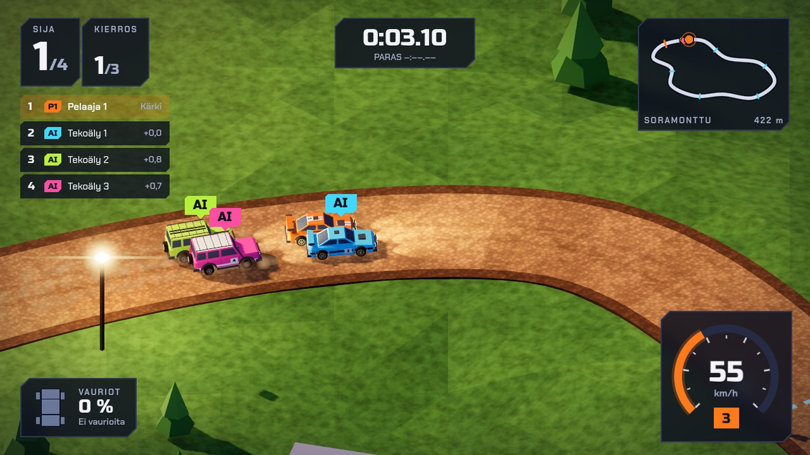
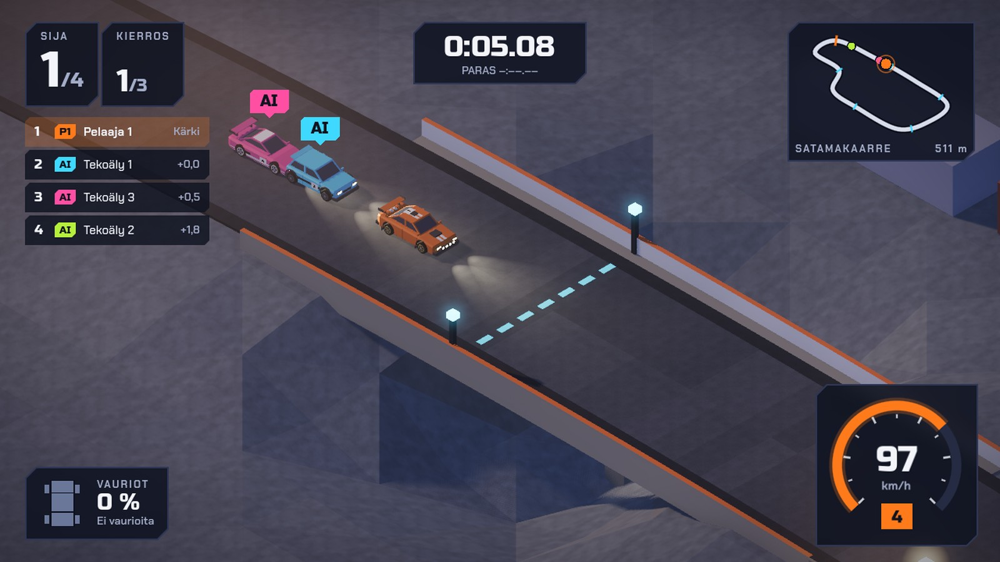
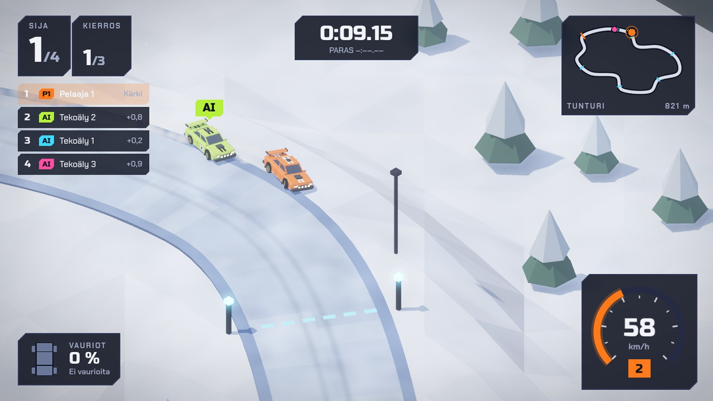
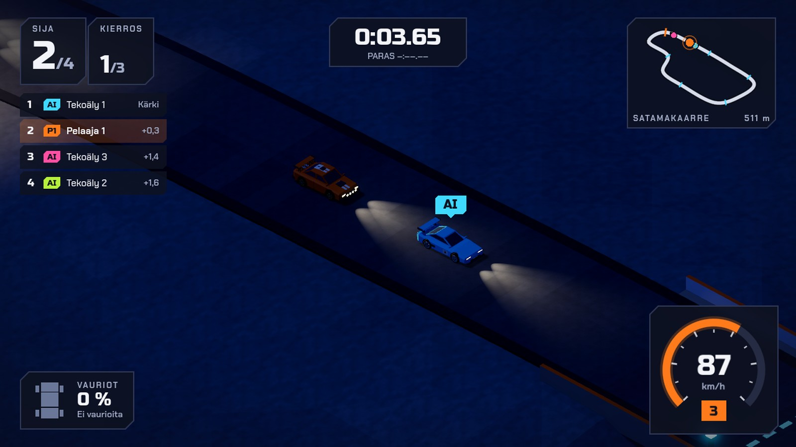
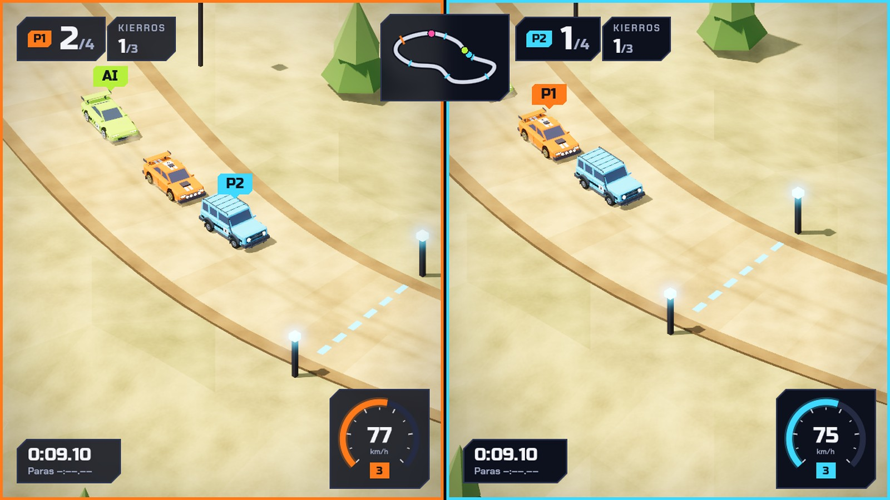
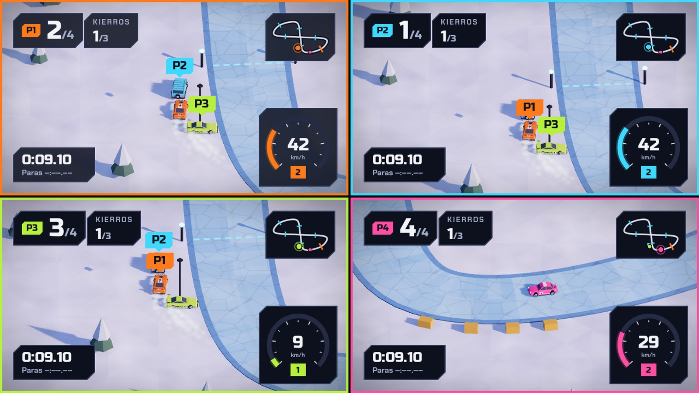
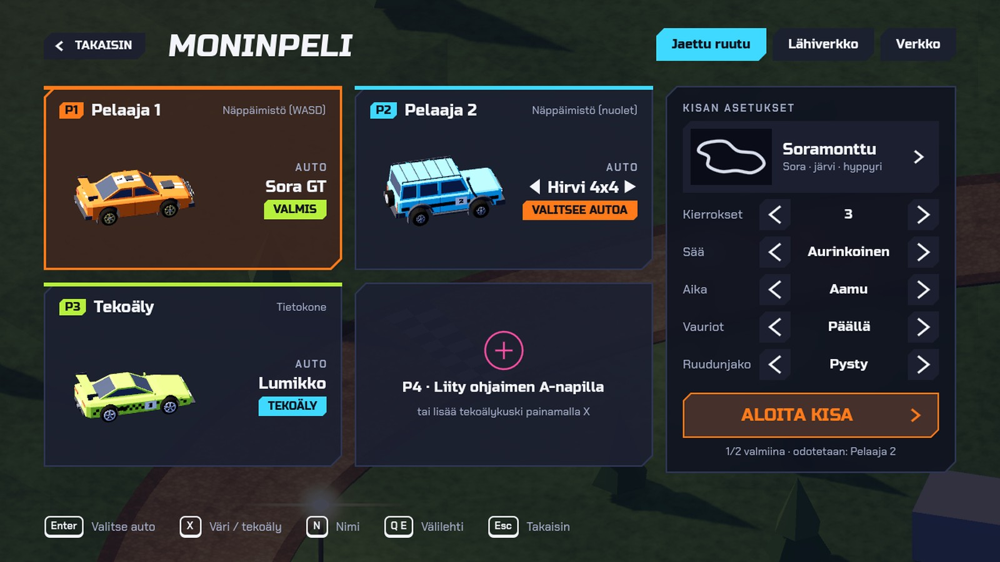
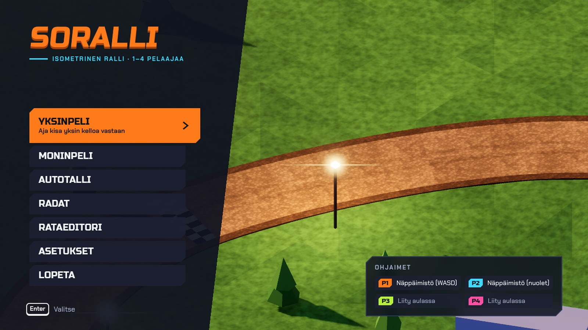
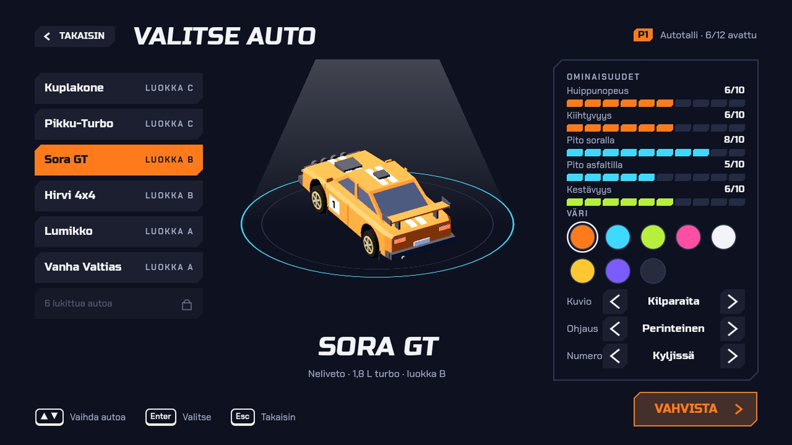
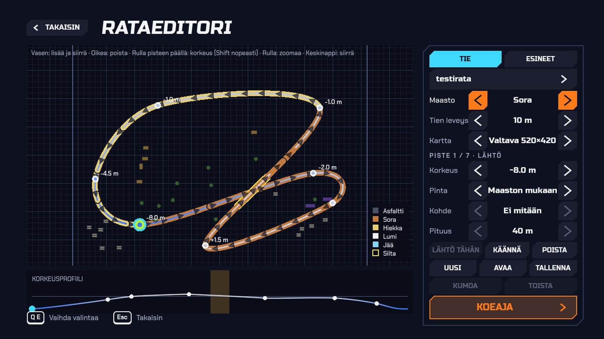

# SoRalli

Isometrinen rallipeli neljälle pelaajalle samalla sohvalla ja kahdeksalle verkossa. Lyhyitä ratoja, soraa, hyppyjä ja sladeja 90-luvun ylhäältä kuvattujen rallipelien hengessä: low-poly-grafiikka ja moderni valaistus.



## Lataa

Uusin versio löytyy [Releases-sivulta](https://github.com/galifragilistic/sorakuninkaat/releases/latest):

- **Windows:** `SoRalli-Windows.zip`. Pura ja käynnistä `SoRalli.exe`. Jos SmartScreen varoittaa, valitse *Lisätietoja → Suorita silti*.
- **macOS** (Apple Silicon ja Intel): `SoRalli-macOS.zip`. Pura ja avaa `SoRalli.app` ensimmäisellä kerralla hiiren oikealla painikkeella → *Avaa*, koska sovellusta ei ole notarisoitu.

## Ominaisuudet

- **Kuusi rataa** soralla, hiekalla, jäällä, asfaltilla ja lumessa, mäkineen, siltoineen, tunneleineen ja hyppyreineen
- **Kuusi autoa** omilla ominaisuuksillaan, väreillä, kuvioilla ja kilpanumerolla kyljessä, katolla tai konepellillä
- **Sää ja vuorokaudenaika:** aamu, päivä, ilta ja yö sekä aurinko, sade, lumisade ja sumu
- **Jaettu ruutu 1–4 pelaajalle** näppäimistöillä ja ohjaimilla, tyhjille paikoille tekoälykuskit
- **Verkkopeli** lähiverkossa tai suoralla IP-osoitteella, enintään 8 pelaajaa
- **Rataeditori:** piirrä oma rata, säädä korkeudet, lisää sillat, tunnelit, hyppyrit ja maisema, ja koeaja heti
- **Kaksi grafiikkatyyliä:** oletuksena Retro (PS1/N64-henkinen: matala resoluutio, terävät pikselit, dithering ja pikselifontti) tai Moderni
- **Suomi tai englanti:** kielen voi vaihtaa asetuksista
- Maaston rinnevarjostus ja korkeuskäyrät, jotka erottavat loivatkin mäet, ja Blenderillä tehdyt low-poly-puut, paalit, kontit, talot, kivet ja rengaspinot
- Reilu kisa: tielle palautus vain tieltä suistuneena ja 10 m taaksepäin, ja ohitetusta portista tulee varoitus *PALAA PORTILLE*
- Vauriot, väliajat, minikartta, moottori- ja renkaiden äänet

## Kuvia

| | |
|---|---|
|  |  |
|  |  |
|  |  |
|  |  |



## Ohjaimet

| | P1 (WASD) | P2 (nuolet) | Ohjain |
|---|---|---|---|
| Kaasu / jarru | W / S | ▲ / ▼ | RT / LT |
| Ohjaus | A / D | ◀ / ▶ | Vasen tikku |
| Käsijarru | Välilyönti | Oikea Shift | X |
| Takaisin tielle | R | Enter | Back |
| Tauko | Esc | Esc | Start |

Moninpeliaulassa pelaaja 1 valitsee kisan asetukset. Muut liittyvät ja hyväksyvät autonsa omalla käsijarrunapillaan (oikea Shift tai ohjaimen A): vasen ja oikea vaihtavat autoa, ylös ja alas väriä.

## Kehitys

Peli on tehty [Godot 4.7](https://godotengine.org):llä (Forward+). Avaa kansio Godotissa ja käynnistä F5:llä.

- [`SPEC.md`](SPEC.md): pelin määrittely ja tila
- [`CHANGELOG.md`](CHANGELOG.md): muutosloki versioittain
- [`CLAUDE.md`](CLAUDE.md): koodityyli ja työtavat
- `mockups/`: näkymien alkuperäiset suunnitelmat
- `tools/blender/build_cars.py`: automallit, rakennetaan Blenderillä (`blender --background --factory-startup --python tools/blender/build_cars.py -- .`)
- `tools/blender/build_props.py`: ratojen maisemamallit (puut, paalit, kontit, talo, kivet, rengaspinot), rakennetaan samalla tavalla
- `env/retro_style.tres`: Retro-tyylin säädöt

**Haarat ja julkaisut:** uudet muutokset tehdään `dev`-haaraan. Jokaisesta devin pushista GitHub Actions tekee testattavat Windows- ja Mac-buildit (Actions-välilehti → ajon artefaktit). Kun muutokset on testattu, dev yhdistetään `master`iin, ja siitä syntyy automaattisesti uusi release.

**Versiointi:** versio (esim. `0.3.0`) on `project.godot`-tiedostossa (`application/config/version`), ja se näkyy päävalikossa. Muutokset kirjataan [`CHANGELOG.md`](CHANGELOG.md):n ylimpään kohtaan. Ennen masteriin yhdistämistä kohdan otsikkoon merkitään julkaisupäivä. Master-build julkaisee version tagilla `v0.3.0` ja käyttää muutoslokin kohtaa release-muistiinpanoina. Build ei julkaise mitään, jos versio on jo julkaistu tai sen otsikosta puuttuu päivämäärä.

Buildin voi tehdä myös itse:

```bash
godot --headless --export-release "macOS" build/macos/SoRalli.app
godot --headless --export-release "Windows Desktop" build/windows/SoRalli.exe
```

Fontit Russo One ja Chakra Petch ovat OFL-lisenssillä (`assets/fonts/`). Retro-tyylin pikselifontti on piirretty koodissa (`ui/pixel_font.gd`).
